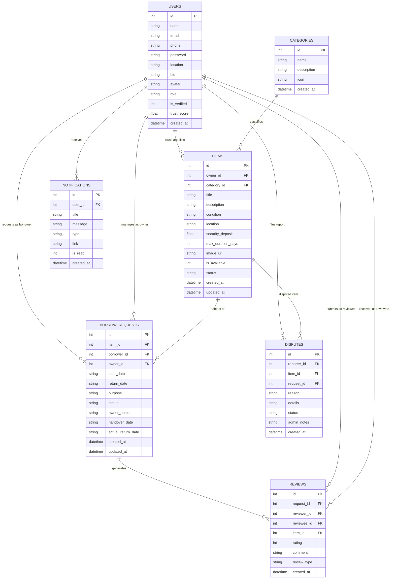

# PROJECT DOCUMENTATION REPORT

## PROJECT TITLE: BorrowBox — A Community-Based Sharing and Borrowing Platform
**Guiding Principle:** "Don't Buy It. Borrow It. Share It. Reuse It."  
**Academic Program:** Bachelor of Computer Applications (FYUGP Mini Project)  
**Document Format:** Monochrome / Black and White Academic Specification

---

## TABLE OF CONTENTS
1. Abstract & Executive Summary
2. Problem Definition & Need for System
3. Proposed System Objectives
4. System Architecture
5. Core System Modules (4)
6. Role-Based Access Control (RBAC)
7. Entity-Relationship (ER) Diagram
8. Transaction Workflow Diagram
9. Database Data Dictionary
10. API Specification & Endpoints
11. Security & Trust Architecture
12. Verification & Testing Strategy
13. Social, Economic & Environmental Impact
14. Conclusion & Future Enhancements

---

## 1. ABSTRACT & EXECUTIVE SUMMARY

In contemporary consumer society, individuals frequently purchase physical items such as cameras, power tools, specialized academic literature, outdoor camping gear, sports kits, and musical instruments that remain idle for long durations following purchase. Simultaneously, other individuals within the same campus, neighborhood, or residential community often require temporary access to these very goods, yet purchasing them outright is economically inefficient or infeasible.

**BorrowBox** is a localized, community-centric digital platform designed to operationalize the circular economy paradigm under the core mantra: *"Don't Buy It. Borrow It. Share It. Reuse It."*

The platform enables item owners to list idle goods with customizable conditions, security deposits, and duration constraints. Borrowers discover available resources using multi-criteria filtering (category, condition, location, availability) and initiate structured borrowing requests. The system governs the complete lifecycle:
```
Requested -> Approved -> Active (Handover) -> Returned -> Completed
```
The architecture integrates a two-way post-transaction rating mechanism that calculates an objective Trust Score for each participant, alongside a centralized Administrative Panel that manages identity verifications, category taxonomies, content moderation, and dispute resolutions.

---

## 2. PROBLEM DEFINITION & NEED FOR SYSTEM

### 2.1 Limitations of Existing Methods
1. **Unstructured Communication Channels:** Ad-hoc borrowing traditionally relies on group messaging, informal word-of-mouth, or commercial equipment rentals. These lack structured availability tracking, automated schedules, and return reminders.
2. **Absence of Trust & Verification Metrics:** Without formal user verification and digital track records, owners fear theft, loss, or property damage.
3. **High Capital Expenditure:** Infrequently used tools or equipment lead to unnecessary spending and rapid depreciation.
4. **No Digital Accountability:** Lack of written handover terms, agreed return dates, and condition recording results in interpersonal disputes.
5. **Resource Underutilization & Environmental Waste:** Idle consumer hardware creates high carbon footprints through duplicate manufacturing.

---

## 3. PROPOSED SYSTEM OBJECTIVES

1. Provide an open, structured catalog for listing and searching idle equipment.
2. Enforce an automated, multi-stage state machine tracking each borrowing transaction from request to return.
3. Build a tamper-resistant community reputation framework via a dynamic Trust Score algorithm ($1.0$ to $5.0$ scale).
4. Provide administrative governance tools for user identity verification, listing moderation, and dispute settlement.
5. Eliminate heavy external infrastructure costs by adopting a self-contained, high-performance architecture.

---

## 4. SYSTEM ARCHITECTURE

The application implements a decoupled Model-View-Controller (MVC) client-server architecture:

```
+-------------------------------------------------------------+
|                     PRESENTATION LAYER                      |
|       React 18 + Vite + Tailwind CSS + Lucide Engine        |
|  (Home, Discovery, Item View, Dashboard, Profile, Admin)    |
+-------------------------------------------------------------+
                              |
                     RESTful JSON / HTTP
                              |
+-------------------------------------------------------------+
|                      APPLICATION LAYER                      |
|               Node.js + Express.js API Engine               |
|      - Authentication Middleware (JWT + Bcrypt)             |
|      - Transaction State Controller                         |
|      - Trust Score Calculator                               |
|      - Notification & Administrative Dispatcher             |
+-------------------------------------------------------------+
                              |
                     Native SQLite Driver
                              |
+-------------------------------------------------------------+
|                       DATABASE LAYER                        |
|                     SQLite File Engine                      |
|         (users, categories, items, borrow_requests,         |
|             reviews, notifications, disputes)               |
+-------------------------------------------------------------+
```

---

## 5. CORE SYSTEM MODULES (4)

### Module 1: User Registration, Authentication & Profile Management
- **Registration & Verification:** Captures user name, email, contact number, encrypted password, and local geographic location (campus, neighborhood, apartment complex).
- **Authentication:** Issues cryptographically signed JSON Web Tokens (JWT) with secure expiration. Passwords are salted and hashed using `bcryptjs` (cost factor 10).
- **Profile & Track Record:** Aggregates verified identity status, cumulative rating stars, active items listed, completed loans, and completed borrows.

### Module 2: Item Listing & Search Discovery
- **Listing Engine:** Enables owners to post listings with titles, category IDs, rich descriptions, physical condition (*Brand New*, *Like New*, *Good*, *Fair*), location, refundable security deposit (INR), maximum borrowing window (days), and imagery.
- **Search & Filtering:** Real-time keyword query against titles and descriptions, category taxonomy filtering, condition filtering, location matching, and instant availability toggling.

### Module 3: Borrowing Request, Lifecycle Management & Notifications
- **Request Creation:** Borrower designates specific start and return dates along with usage purpose. Validates date ranges ($start \ge today$, $return \ge start$, $duration \le max\_duration$).
- **Lifecycle Engine:**
  - `Requested`: Sent to owner; item remains open for view.
  - `Approved`: Owner accepts terms; parties coordinate physical pickup.
  - `Active`: Handover confirmed; item marked unavailable ($is\_available = 0$).
  - `Returned`: Borrower hands item back; availability restored ($is\_available = 1$).
  - `Completed`: Closed transaction; opens mutual rating and review window.
  - `Rejected` / `Cancelled`: Aborted transaction; item availability preserved.
- **In-App Notification Dispatcher:** Real-time event notifications for pending requests, status updates, due date alerts, and review requests.

### Module 4: Rating, Trust Score & Administrative Panel
- **Two-Way Mutual Rating:** Post-handover evaluation where borrower reviews owner and item, and owner reviews borrower punctuality and care.
- **Trust Score Algorithm:** Computes a weighted Bayesian average blend:
  $$\text{Score} = \frac{(5.0 \times 2) + (\sum \text{Ratings})}{2 + N}$$
- **Admin Supervision:**
  - Identity verification badge assignment (`is_verified`).
  - Catalog category creation and deletion.
  - Listing moderation (toggle `active`, `flagged`, `hidden`).
  - Dispute review and administrative resolution notes.

---

## 6. ROLE-BASED ACCESS CONTROL (RBAC)

The system supports distinct user roles with clear permission boundaries:

| Permission / Functionality | Borrower | Owner / Lender | Platform Administrator |
|---|:---:|:---:|:---:|
| Search & Filter Items | Yes | Yes | Yes |
| Submit Borrow Request | Yes | Self-Exempt | Yes |
| Track Borrowing Status | Yes | N/A | Yes |
| List Items to Share | Yes | Yes | Yes |
| Approve / Reject Requests | N/A | Yes | Yes |
| Confirm Handover (Mark Active) | N/A | Yes | Yes |
| Confirm Return (Mark Returned)| N/A | Yes | Yes |
| Submit Reviews & Feedback | Yes | Yes | N/A |
| Verify Community Users | No | No | Yes |
| Manage Categories | No | No | Yes |
| Moderate / Hide Listings | No | No | Yes |
| Resolve System Disputes | No | No | Yes |

*Note: In BorrowBox, any registered user can act as both Borrower and Owner seamlessly within the same unified account.*

---

## 7. ENTITY-RELATIONSHIP (ER) DIAGRAM

The relational data model below illustrates entity structures, primary keys (PK), foreign keys (FK), and association cardinalities:



---

## 8. TRANSACTION WORKFLOW DIAGRAM

The state diagram depicts valid transition events throughout the lifecycle of an exchange:

```mermaid
stateDiagram-v2
    [*] --> Requested : Borrower submits dates and purpose

    Requested --> Approved : Owner approves request
    Requested --> Rejected : Owner declines request
    Requested --> Cancelled : Borrower withdraws request

    Approved --> Active : Physical handover confirmed (Item locked)
    Approved --> Cancelled : Either party aborts before handover

    Active --> Returned : Borrower returns item; Owner verifies condition
    
    Returned --> Completed : Owner confirms closure
    
    Completed --> [*] : Both parties submit ratings & trust updates
    Rejected --> [*]
    Cancelled --> [*]
```



---

## 9. DATABASE DATA DICTIONARY

### 9.1 Table: `users`
| Column | Data Type | Constraint | Description |
|---|---|---|---|
| `id` | INTEGER | PRIMARY KEY AUTOINCREMENT | Unique user identifier |
| `name` | TEXT | NOT NULL | User's full personal or commercial name |
| `email` | TEXT | UNIQUE NOT NULL | Account login address |
| `phone` | TEXT | NULLABLE | Contact telephone number |
| `password` | TEXT | NOT NULL | 60-character bcrypt encrypted hash |
| `location` | TEXT | NOT NULL | College, neighborhood, or city address |
| `bio` | TEXT | NULLABLE | Biography statement |
| `avatar` | TEXT | NULLABLE | URI reference to profile image |
| `role` | TEXT | DEFAULT 'user' | Access level: `'user'` or `'admin'` |
| `is_verified` | INTEGER | DEFAULT 0 | Verification flag: `1` = verified, `0` = unverified |
| `trust_score` | REAL | DEFAULT 5.0 | Dynamic trust score rating (1.0 to 5.0) |
| `created_at` | DATETIME | DEFAULT CURRENT_TIMESTAMP | Registration timestamp |

### 9.2 Table: `categories`
| Column | Data Type | Constraint | Description |
|---|---|---|---|
| `id` | INTEGER | PRIMARY KEY AUTOINCREMENT | Category ID |
| `name` | TEXT | UNIQUE NOT NULL | Category classification name |
| `description`| TEXT | NULLABLE | Functional scope of category |
| `icon` | TEXT | NULLABLE | Identifier for UI icon rendering |
| `created_at` | DATETIME | DEFAULT CURRENT_TIMESTAMP | Creation timestamp |

### 9.3 Table: `items`
| Column | Data Type | Constraint | Description |
|---|---|---|---|
| `id` | INTEGER | PRIMARY KEY AUTOINCREMENT | Item identifier |
| `owner_id` | INTEGER | FOREIGN KEY (`users.id`) | Reference to item owner |
| `category_id`| INTEGER | FOREIGN KEY (`categories.id`) | Reference to category |
| `title` | TEXT | NOT NULL | Headline name of listed item |
| `description`| TEXT | NOT NULL | Detailed specifications and conditions |
| `condition` | TEXT | NOT NULL | Grade: Brand New, Like New, Good, Fair |
| `location` | TEXT | NOT NULL | Handover location description |
| `security_deposit`| REAL | DEFAULT 0.00 | Refundable security deposit (INR) |
| `max_duration_days`| INTEGER| DEFAULT 7 | Maximum days per single borrow |
| `image_url` | TEXT | NULLABLE | Photo URI |
| `is_available`| INTEGER | DEFAULT 1 | `1` = ready to borrow, `0` = currently loaned |
| `status` | TEXT | DEFAULT 'active' | Moderation status: `'active'`, `'hidden'`, `'flagged'` |
| `created_at` | DATETIME | DEFAULT CURRENT_TIMESTAMP | Date listing published |
| `updated_at` | DATETIME | DEFAULT CURRENT_TIMESTAMP | Date listing modified |

### 9.4 Table: `borrow_requests`
| Column | Data Type | Constraint | Description |
|---|---|---|---|
| `id` | INTEGER | PRIMARY KEY AUTOINCREMENT | Transaction ID |
| `item_id` | INTEGER | FOREIGN KEY (`items.id`) | Targeted item reference |
| `borrower_id`| INTEGER | FOREIGN KEY (`users.id`) | Requesting user |
| `owner_id` | INTEGER | FOREIGN KEY (`users.id`) | Lending owner |
| `start_date` | TEXT | NOT NULL | Scheduled start date (YYYY-MM-DD) |
| `return_date`| TEXT | NOT NULL | Scheduled return date (YYYY-MM-DD) |
| `purpose` | TEXT | NULLABLE | Stated reason and care pledge |
| `status` | TEXT | DEFAULT 'Requested' | State: Requested, Approved, Active, Returned, Completed, Cancelled, Rejected |
| `owner_notes`| TEXT | NULLABLE | Private lender instructions |
| `handover_date`| TEXT | NULLABLE | Timestamp when item physically handed over |
| `actual_return_date`| TEXT | NULLABLE | Timestamp when item returned |
| `created_at` | DATETIME | DEFAULT CURRENT_TIMESTAMP | Request submission timestamp |
| `updated_at` | DATETIME | DEFAULT CURRENT_TIMESTAMP | Status update timestamp |

### 9.5 Table: `reviews`
| Column | Data Type | Constraint | Description |
|---|---|---|---|
| `id` | INTEGER | PRIMARY KEY AUTOINCREMENT | Review ID |
| `request_id` | INTEGER | FOREIGN KEY (`borrow_requests.id`) | Associated transaction |
| `reviewer_id`| INTEGER | FOREIGN KEY (`users.id`) | User authoring review |
| `reviewee_id`| INTEGER | FOREIGN KEY (`users.id`) | User receiving rating |
| `item_id` | INTEGER | FOREIGN KEY (`items.id`) | Associated item |
| `rating` | INTEGER | CHECK (1 <= rating <= 5) | Integer star rating |
| `comment` | TEXT | NULLABLE | Narrative evaluation |
| `review_type`| TEXT | NOT NULL | `'borrower_to_owner'` or `'owner_to_borrower'` |
| `created_at` | DATETIME | DEFAULT CURRENT_TIMESTAMP | Timestamp of review |

### 9.6 Table: `notifications`
| Column | Data Type | Constraint | Description |
|---|---|---|---|
| `id` | INTEGER | PRIMARY KEY AUTOINCREMENT | Notification ID |
| `user_id` | INTEGER | FOREIGN KEY (`users.id`) | Target recipient |
| `title` | TEXT | NOT NULL | Short alert title |
| `message` | TEXT | NOT NULL | Informative alert body |
| `type` | TEXT | DEFAULT 'info' | Category: request, approval, active, return, review, system |
| `link` | TEXT | NULLABLE | Internal route navigation link |
| `is_read` | INTEGER | DEFAULT 0 | Read flag: `0` = unread, `1` = read |
| `created_at` | DATETIME | DEFAULT CURRENT_TIMESTAMP | Alert generation time |

### 9.7 Table: `disputes`
| Column | Data Type | Constraint | Description |
|---|---|---|---|
| `id` | INTEGER | PRIMARY KEY AUTOINCREMENT | Report identifier |
| `reporter_id`| INTEGER | FOREIGN KEY (`users.id`) | User initiating report |
| `item_id` | INTEGER | NULLABLE | Relevant item |
| `request_id` | INTEGER | NULLABLE | Relevant transaction |
| `reason` | TEXT | NOT NULL | Reason classification |
| `details` | TEXT | NOT NULL | Factual incident account |
| `status` | TEXT | DEFAULT 'pending' | State: pending, investigating, resolved, dismissed |
| `admin_notes`| TEXT | NULLABLE | Administrative findings |
| `created_at` | DATETIME | DEFAULT CURRENT_TIMESTAMP | Date submitted |

---

## 10. API SPECIFICATION & ENDPOINTS

### 10.1 Authentication (`/api/auth`)
- `POST /register`: Register new account with password hashing.
- `POST /login`: Authenticate email/password; returns JWT token.
- `POST /demo-login`: Immediate one-click role-based sign in for evaluators (`admin`, `owner`, `borrower`).
- `GET /me`: Fetch authenticated user profile and aggregate borrowing/lending stats.
- `PUT /profile`: Update user contact, bio, and location.
- `GET /user/:id`: Retrieve public profile and item listings for any member.

### 10.2 Items (`/api/items`)
- `GET /`: Search and filter catalog by category, condition, location, keyword, availability, and sort order.
- `GET /categories`: Retrieve all categories along with active item counts.
- `GET /my/listings`: Retrieve all items owned by the authenticated caller.
- `GET /:id`: Retrieve full item details, owner trust profile, and reviews.
- `POST /`: Publish a new item listing.
- `PUT /:id`: Update item specifications or availability toggle.
- `DELETE /:id`: Remove an item (permitted only if no active loans exist).

### 10.3 Borrowing Requests (`/api/requests`)
- `POST /`: Submit a borrow request with start date, return date, and purpose.
- `GET /borrower`: List outgoing requests sent by authenticated user.
- `GET /owner`: List incoming requests received for owner's equipment.
- `PATCH /:id/status`: Transition transaction status (`Approved`, `Rejected`, `Active`, `Returned`, `Completed`, `Cancelled`).

### 10.4 Reviews (`/api/reviews`)
- `POST /`: Submit 1 to 5 star rating and comment; triggers trust score recalculation.
- `GET /user/:userId`: List all reviews received by a specific user.

### 10.5 Notifications (`/api/notifications`)
- `GET /`: Fetch user alerts and unread count.
- `PATCH /:id/read`: Mark single notification as read.
- `PATCH /read-all`: Mark all notifications as read.

### 10.6 Administration (`/api/admin`)
- `GET /stats`: High-level system activity metrics.
- `GET /users`: List all platform users.
- `PATCH /users/:userId/verify`: Toggle user identity verification badge.
- `DELETE /users/:userId`: Permanently delete user and dependent data.
- `GET /listings`: Administrative list of all listings.
- `PATCH /listings/:itemId/status`: Moderate item (`active`, `flagged`, `hidden`).
- `POST /categories`: Add new category.
- `DELETE /categories/:id`: Delete empty category.
- `POST /disputes`: File a report (accessible to any authenticated user).
- `GET /disputes`: List all user disputes.
- `PATCH /disputes/:id/status`: Update dispute resolution state and notes.

---

## 11. SECURITY & TRUST ARCHITECTURE

1. **Stateless JWT Authorization:** Every sensitive request requires a Bearer token in the `Authorization` header. Expired or tampered tokens are rejected with HTTP 401/403.
2. **Cryptographic Password Storage:** Passwords are never stored in plaintext. They undergo salted 1-way hashing using `bcryptjs`.
3. **Role Enforcement Middleware:** Administrative routes are protected by sequential middleware checks (`authenticateToken` followed by `requireAdmin`).
4. **Relational Data Integrity:** Foreign key constraints are enforced (`PRAGMA foreign_keys = ON;`) to prevent orphan records upon deletion.
5. **Concurrency Management:** Write-Ahead Logging (`PRAGMA journal_mode = WAL;`) ensures non-blocking concurrent reads and resilient transactions.

---

## 12. VERIFICATION & TESTING STRATEGY

| Test Scenario | Input / Action | Expected Outcome | Result |
|---|---|---|:---:|
| **User Sign-Up** | Form inputs with valid email and password | Encrypted password saved; JWT token generated; welcome alert dispatched | Passed |
| **Authentication** | Valid credentials | HTTP 200 returned with user payload and token | Passed |
| **Search Filter** | Filter by category "Power Tools & DIY" | Returns only items matching category ID 2 | Passed |
| **Duration Check** | Requesting 10 days for an item with max duration 5 | Request rejected with descriptive error message | Passed |
| **Handover Lock** | Marking request as "Active" | Associated item's `is_available` flag set to 0 | Passed |
| **Return Unlock** | Marking request as "Returned" | Associated item's `is_available` flag restored to 1 | Passed |
| **Two-Way Rating** | Submitting 5-star review after completion | Review recorded; reviewee's Trust Score recalculates | Passed |
| **Admin Privilege** | Non-admin user querying `/api/admin/stats` | Access denied with HTTP 403 Forbidden | Passed |
| **User Cleanup** | Deleting user via Admin or CLI script | Cascade deletion removes all related items and requests | Passed |

---

## 13. SOCIAL, ECONOMIC & ENVIRONMENTAL IMPACT

1. **Economic Savings:** Eliminates the financial burden of purchasing expensive, short-term goods (e.g. tools for a single home project or cameras for a single event).
2. **Community Trust Building:** Mutual reviews and administrative identity verifications cultivate accountability among local peers and students.
3. **Circular Economy & Environmental Sustainability:** Maximizing the utilization lifecycle of idle equipment directly curtails unnecessary consumer manufacturing and e-waste generation.
4. **Hyperlocal Optimization:** Handover locations are optimized for local colleges, housing complexes, and tech zones, minimizing shipping carbon footprints.

---

## 14. CONCLUSION & FUTURE ENHANCEMENTS

BorrowBox successfully fulfills the requirements of a modern community sharing platform by uniting inventory discovery, an automated transaction state machine, and trust metrics into a reliable software ecosystem.

### Potential Future Enhancements:
1. **Integrated Escrow Payment Gateway:** Incorporate digital UPI/Stripe deposit holding and automatic refund upon successful return verification.
2. **QR Code Verification on Handover:** Borrower and owner scan each other's device-generated QR codes to cryptographically confirm physical handovers.
3. **Geospatial Distance Calculation:** Integrate OpenStreetMap / Leaflet to compute exact walking distances between community members.
4. **Automated Return Due Notifications:** Automated SMS or WhatsApp reminders 24 hours prior to scheduled return deadlines.

---
*Report prepared for BCA FYUGP Mini Project Evaluation.*
